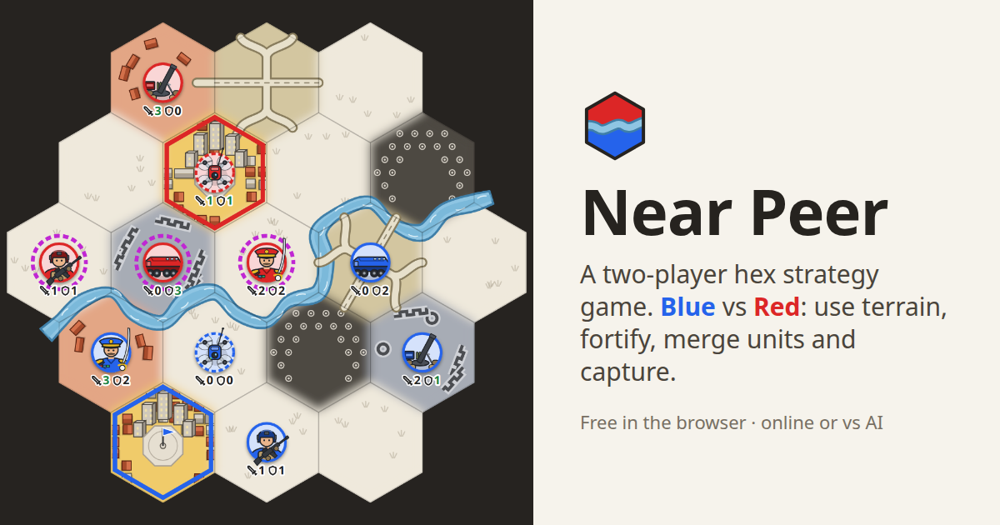

# Near Peer

Use strategy to defeat your opponent on the battlefield with using terrain and movement.
A two-player hex board game where you control military troops and place fortifications.
Combine and seperate units to concentrate power where you need it.

[](https://zaffer.github.io/near-peer/)

## Play

**[Play Near Peer in your browser](https://zaffer.github.io/near-peer/)**: free, nothing to install and no account needed.

- **Against the computer** on Easy, Medium or Hard, as Blue or Red.
- **Online with a friend.** Create a game, send them the link, and anyone else who opens it can watch.
- **Two players on one screen**, taking turns.

It works on phones and tablets as well as computers, in light or dark mode.

## How it plays

The board has 19 hexes, with a river between Blue's half and Red's.

1. **Build.** Take turns placing terrain in your half: a capital, a town, a road, a fortification and a minefield. Then place your five units: Rifle Squad, Armoured Carrier, Mortar Team, Recon Drone and Commander.
2. **Fight.** On your turn, move one unit. Every unit attacks every enemy in range all the time, so attacks add up: step onto an enemy whose defence is no more than your combined attack, and it's captured.
3. **Merge and split.** Move a unit onto one of your own and they merge into a stronger unit, with their attack and defence added together. Every mix of the five makes a different unit, 31 in all, up to the Nuke. Merged units can split up again.
4. **Win** by getting a unit onto the enemy capital, or by capturing every enemy unit. If both sides build a Nuke, nobody wins.

Terrain counts for whoever stands on it: towns add attack, fortifications add defence, roads speed you up and minefields slow you down. The full rules are in [RULES.md](RULES.md).

### Controls
- Click a unit, then click where it should go, or drag it there. The arrow turns magenta if the move would capture.
- Hover over a unit to see every enemy unit attacking it, and the total against its defence.
- Keys: `E` ends your turn, `Z` undoes, `Esc` cancels.

## Run it yourself

It's plain HTML and JavaScript with no build step. Serve the folder and open it in a browser:

```sh
python3 -m http.server
# then open http://localhost:8000
```

Browsers won't load JavaScript modules from a file, so opening `index.html` by double-clicking doesn't work. The first load needs an internet connection for [alien-signals](https://github.com/stackblitz/alien-signals).

Some addresses start a game straight away:
- `?vs=easy`, `?vs=medium` or `?vs=hard` plays the computer. Add `&side=red` to play Red.
- `?quick` skips the build with a random setup.

To play online between two computers, host the folder somewhere public, such as GitHub Pages. A `localhost` link only works on your own machine, though that's handy for testing in two tabs.

Open `tests.html` (served, like the game) to run the tests.

## How it works

- **No game server.** Online games connect the two browsers directly over WebRTC ([Trystero](https://github.com/dmotz/trystero)), and both browsers check every move against the rules. Some strict office or mobile networks block these connections.
- **The computer player runs in your browser**, in a Web Worker so the page doesn't freeze.
- **On X**, a post linking the game shows a playable card that starts a game against the computer on Easy. The ↗ button opens it in its own tab.
- **Statistics.** The site counts visits and games with [GoatCounter](https://nearpeer.goatcounter.com), which is public and uses no cookies. Each finished or abandoned game is sent as a compressed record of its moves, with nothing about the player, and nothing is sent from `localhost`. [stats.html](stats.html) shows how the games went, with a **Watch** button to replay any of them.

## Code

| File | What's in it |
|------|--------------|
| `js/rules.js` | Every number, zone, terrain effect and option, and the 31 units and their skills. **Tune the game here.** |
| `js/engine.js` | The game logic: `apply(state, action)`, with every legality check. |
| `js/ui.js` | The board, the panel and the Menu. It only ever asks the engine what's legal. |
| `js/signals.js` | Reactive state from alien-signals (version pinned here). |
| `js/hex.js` | Hex grid maths. |
| `js/mapview.js`, `js/unitart.js`, `js/icons.js`, `js/colours.js` | How the board and units are drawn. Purely visual. |
| `js/effects.js` | Animations: units moving, attacks, captures, blasts. |
| `js/online.js` | Online play: joining a room, exchanging moves, deciding who sits where. |
| `js/ai.js`, `js/ai-sim.js` | The computer player: a search over whole turns, using a fast copy of the battle rules. |
| `js/versus.js`, `js/ai-worker.js` | A game against the computer, with the AI in a Web Worker. |
| `js/stats.js`, `js/replay.js`, `js/statspage.js` | Sending game records, replaying them, and the statistics page. |
| `tools/games.js` | Fetches played games from GoatCounter into `data/games.json`. A daily GitHub Action runs it, and it needs a `GOATCOUNTER_TOKEN` secret. |
| `tools/arena.js` | Plays the AI against itself without a browser, for tuning: `bun tools/arena.js 64 200 '{"advance":1.2}' hard`. |
| `tests/` | One test per rule, plus online play and the AI. Update the matching test when you change a rule on purpose. |

More docs:
- [RULES.md](RULES.md): the rules in full.
- [UNITS.md](UNITS.md): the 31 units and ideas for their abilities.
- [AMENDMENTS.md](AMENDMENTS.md): rule ideas and past decisions.

## Roadmap

A **naval expansion** is being considered, with ocean around the map, ports on the coast and boats on the river. Nothing is decided yet.
